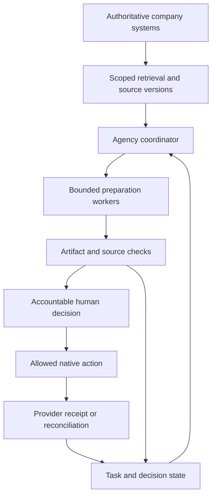

# Agency knowledge and asynchronous execution

Date: 9 September 2026. Status: local planning candidate; connected execution remains a separate acceptance stage.

## Product decision

Extend engagement delivery with one source-linked agency control brief, an owned decision queue, and bounded specialist preparation. The primary outcome is lower coordination time per accepted engagement milestone while maintaining reliable commitments and human decision quality.

Company knowledge, candidate records, commercial offers and meetings require distinct authorities. Maintain the existing office suite, ATS/CRM and finance system. Reuse their native connectors and MCPs. Build the coordination contracts and missing cross-system behavior only after verifying an actual need. See [current connector research](CONNECTOR-RESEARCH-2026-09-09.md).

## Scope and implementation

`ana-agency-control` adds a strict metadata/task/meeting contract, deterministic planner, fictional example, specialist handoff packets and an internal Markdown brief. It checks source agency/engagement scope, declared access, freshness, versions, allowed domain, required task context and dependency state. It proposes asynchronous treatment only for eligible status/decision work; it protects interviews, relationships, workshops, conflict, care and explicitly live-required meetings.

The planner does not fetch knowledge, authenticate users, enforce permissions in a provider, start workers, create tasks, or change calendars. `access_state` and completed-task status are supplied declarations. Host execution must independently verify them. The output's meeting-minute opportunity is modeled gross time, not measured savings.

## Connected target

This diagram describes the connected target. The candidate implements local planning and handoff contracts only. Each actual source read/action requires current resource permission. Personal reflection and clinical records are outside the employer retrieval domain.

## Acceptance requirements

| ID | Requirement | Candidate evidence / remaining gate |
| --- | --- | --- |
| A01 | No planning from stale, revoked, mismatched or unrelated sources | Local behavioral tests; live ACL/revocation tests pending |
| A02 | Preparation has specialist, responsible human and exact source versions | Local handoff packets; host worker execution/readback pending |
| A03 | Service and employment offers have different accountable decisions | Separate routes and tests; actual named owners pending |
| A04 | Dependencies block premature dispatch | Local DAG validation and waiting states; durable task transitions pending |
| A05 | Meeting reduction preserves live-purpose work and explicit organizer authority | Local purpose/source tests; no calendar writes |
| A06 | Knowledge answers cite current authorized evidence or abstain | Source registry and workflow contract; live retrieval/evaluation pending |
| A07 | Candidate lists migrate without false merges or duplicated records | Source-level intake and reconciliation contract; selected ATS/import test pending |
| A08 | Repeated execution cannot duplicate consequential actions | Existing local billing reservation tests; hosted/provider action deduplication pending |

Do not equate a local source check with a security perimeter, or a successful plan with a completed agency workflow. Fresh installation, live access, operator adoption and commercial outcomes require their own receipts.

## Human and specialist roles

The coordinator consolidates work. Knowledge, talent, commercial, meeting, finance and document specialists prepare bounded outputs. Human preparation belongs to the coordinator, talent operator or document operator. Ana and the client's accountable people retain the applicable decisions. See the [team contract](../plugins/ana-hr-operations/skills/ana-agency-control/references/agent-team.md).

A host may run independent preparation concurrently, with a proposed ceiling of three workers across the agency. Source changes, blocked permissions and unresolved authority stop the affected packet. Use one durable workflow engine when recurring background execution is justified; keep its development credentials out of the daily worker toolset.

## Rollout and metrics

Identify exact company-owned sources and owners first. Run the fictional example, then one explicitly authorized engagement with read-only retrieval. Evaluate twenty recurring company questions for current-source accuracy, missing-source abstention and forbidden-domain refusal. Introduce narrow writes only after identity, approval, deduplication and provider-readback gates pass.

Baseline two comparable working weeks; compare a two-week async pilot. Proposed targets: 30% fewer internal status-meeting minutes, 25% lower total coordination time per comparable engagement, at least 95% on-time commitments, and no deterioration in decision latency or reviewed work quality. Include added async work and rework. All business metrics remain unmeasured.

Use the [meeting protocol](../plugins/ana-hr-operations/skills/ana-agency-control/references/async-decisions.md) and blank [coordination observation CSV](templates/coordination-observations.csv). Keep source data and populated observations in approved private systems.
