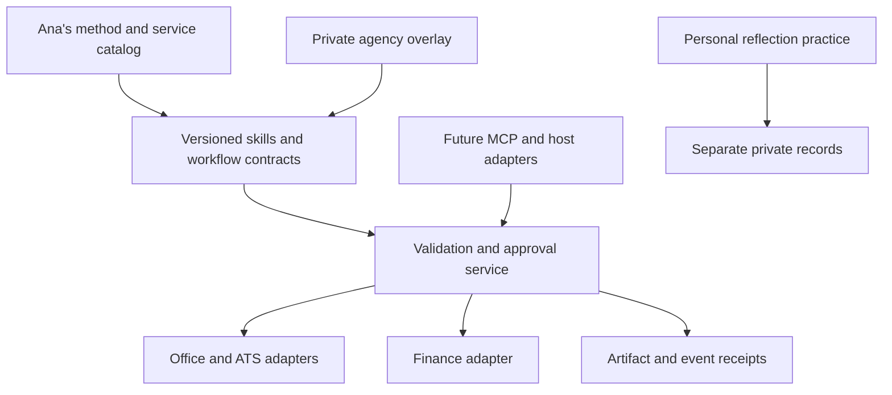

# HR excellence product requirements

Date: 9 September 2026. Status: proposed roadmap with a bounded implementation candidate. Product/method decision owner: Ana. Technical delivery owner: Frank. This describes operational responsibility, not a transfer of existing IP or a signed commercial agreement.

## Decision and customer promise

Build a reusable agency delivery system around a specific promise: each engagement has an accountable owner, approved scope, reliable documents, traceable billing preparation, and a reviewed client handoff. Extend that system with voluntary team practices that produce observable working agreements.

Ana governs her service standards, methodology, curriculum, and client experience. Generic infrastructure remains reusable. Other agencies install their own identity, policies, approvers, templates, and service catalog through a private overlay.

Start with boutique HR/recruiting agencies using established office, ATS, and finance tools. Qualifying hypothesis: 2–15 operators, repeated client engagements, owner review bottlenecks, and sufficient recurring admin to measure. These ranges select a pilot; they are not market-size evidence. The buyer is the agency owner, the champion an operations lead, the daily users coordinators and delivery operators. In-house teams at 20–200-person businesses and independent facilitators are secondary products after this workflow proves useful.

Exclude initial buyers seeking autonomous hiring decisions, emotion scoring, therapy delivered by an agent, enterprise HRIS replacement, or open-ended bespoke integrations.

## Product ownership and responsibilities

| Area | Accountable | Responsible | Release evidence |
| --- | --- | --- | --- |
| Method, service quality, curriculum | Ana | Designated practice lead | Reviewed version and allowed uses |
| Client scope and delivery | Ana or explicitly delegated lead | Engagement coordinator | Acceptance, next action, due date |
| Offer and invoice approval | Named business approver | Finance/document operator | Source, revision, reconciliation, explicit approval |
| Employment decisions | Client's designated decision-maker | Client's human process | Job-relevant evidence and recorded human decision |
| Software and integrations | Frank | Technical maintainer | Tests, security review, rollback, support owner |
| Team session | Ana for method; client sponsor for engagement | Facilitator | Agreed scope, participation choices, artifact review |
| Personal or clinical work | Separate qualified practice owner | Appropriate practitioner | Separate scope, records, and consent pathway |

Ana defines policy once and delegates preparation and routine review through named roles. Do not make every routine task require a meeting with her. The current plugin still requires explicit approval at consequential boundaries; any future standing delegation must be written, limited, revocable, and enforced by the runtime.

## Architecture

Current implementation uses skills, JSON contracts, local validators, reviewed documents, and a single-agency SQLite billing preparation ledger. It does not implement the approval service, multi-tenant state, MCP server, or billing adapter shown as target architecture.

Reuse the current Codex distribution first. Generate Claude/Hermes host wrappers from the same contracts only after host-specific fixture runs. A Codex plugin is not proof of ChatGPT app compatibility. Any ChatGPT app requires a separate host integration and end-to-end validation.

Connect existing office/ATS/finance tools through their approved connectors before building new ones. Build a custom MCP only when at least three paying agencies need the same missing cross-system workflow and the behavior has stable schemas, identity, and audit requirements. Keep the domain service authoritative; host prompts cannot authorize a mutation.

Target hosted state: transactional relational database for tenant, engagement, billable event, artifact revision, approval, and outbox; object storage for versioned artifacts; one durable job runner for retries. Reuse an existing verified Starlight service where it already provides these controls. Do not add separate workflow engines for each brand.

## Data contracts for hosted work — proposed

| Record | Required invariants |
| --- | --- |
| AgencyPolicy | Tenant, version, permitted purposes, roles, retention, supported currencies, finance adapter, delegated limits |
| Engagement | Tenant + client alias + engagement ID; owner; approved source references; no duplicated candidate records |
| BillableEvent | Immutable ID, accepted commercial source, event type, amount basis, evidence reference; event consumed at most once per billing policy |
| InvoiceDraft | Billable-event ID, finance-system draft ID, currency/precision, tax-policy reference, calculated totals, artifact digest |
| ApprovalReceipt | Authenticated actor, role, tenant, operation, payload digest, destination, policy version, expiry; changing payload invalidates approval |
| DeliveryReceipt | Provider ID, artifact revision, recipient, outcome, timestamp, retry key; no claim of success until provider readback |
| ResearchEntry | Source, claim, interpretation, limits, rights/use notes, reviewer, expiry; no personal disclosures |
| TeamPractice | Team alias, observable goal, role owners, participation choices, agreements, follow-through dates; no individual assessment |

Issuer identity, tax fields, numbering, and credit documents belong to the jurisdiction-approved finance system. Do not infer a universal VAT rule. The local renderer is a draft helper with a documented arithmetic scope.

## Critical workflows

**Agency delivery:** first call → fact readback → kickoff approval → role/process preparation → offer approval → delivery evidence → billable event → reconciled draft → human finance approval → provider issue/send → payment reconciliation. Every arrow has an owner and an explicit failed/pending state. The current implementation covers local preparation and validation, not the full connected lifecycle.

**Team practice:** approved organizational goal → evidence/applicability review → voluntary session draft → Ana/facilitator review → participant-facing materials in approved templates → facilitated session → agreed working behaviors → days 7/14/30 follow-through. Employer outputs contain agreed process artifacts; personal reflection stays outside employer records.

**Method productization:** Ana supplies authorized original material → method editor separates claims, exercises, and teaching notes → research review → bilingual edit → master templates/audio/video → facilitator rehearsal → participant pack → versioned release. AI drafts and checks; only Ana can approve statements in her voice. Do not create fake case studies or professional credentials.

## Functional requirements and acceptance

| ID | Requirement | Acceptance |
| --- | --- | --- |
| F01 | Predictable draft arithmetic | Regression suite rejects malformed/nonfinite amounts; exact rounding fixtures pass |
| F02 | Correct invoice context | Invoice uses its own terms and currency; valid decimal-string inputs render |
| F03 | Team-practice draft | Valid brief renders agenda, owned agreements, dates, evidence limits, review-required status |
| F04 | Safe malformed-input handling | Invalid records fail without a draft; unknown team record fields rejected |
| F05 | Artifact-bound approval | Changed amount, recipient, source, or version invalidates authorization; forged JSON approver cannot approve |
| F06 | Idempotent accounting | Duplicate/retried event produces one provider draft; timeout enters reconciliation rather than blind retry |
| F07 | Tenant separation | Cross-tenant reads, search, artifact access, and writes fail in integration tests |
| F08 | Private overlay portability | A second agency completes fictional setup with its own policy and approvers without changing shared code |
| F09 | Template fidelity | Exact approved master copied; document readback and human visual review recorded |
| F10 | Method release quality | Claim-source mapping, owner approval, EN/ES review, participant materials, and facilitator rehearsal complete |

This candidate implements F01–F04 plus local preparation subsets of F05–F06: registered-source digest matching, artifact/revision-bound manual acknowledgment, one event/number reservation within one ledger, and transaction-safe preparation retries. The local acknowledgment is explicitly unauthenticated; no provider API, authenticated approval, cumulative budget, or cross-ledger duplicate control is implemented. Existing instructions support parts of F08–F10; no live acceptance is asserted. Full F05–F07 continue to block connected accounting or hosted multi-agency launch.

## Operational standards

For hosted APIs: derive tenant and actor from verified auth, enforce resource scopes, validate token audiences, and never pass client tokens to unrelated downstream resources. Store provider credentials outside prompts. Treat imported documents as data; extracted text cannot grant permissions or change tool scope. Require visible recipient and exact revision at send time. Use transactional outbox, retries with backoff, provider reconciliation, and a quarantine queue for ambiguous outcomes.

Log event IDs, state transitions, policy/version hashes, duration, retries, and cost. Avoid raw HR content in logs. Give the agency export, access revocation, retention, and deletion workflows. Define backup/restore ownership before hosting real data. Structural validators are not a security perimeter or a personal-data detector.

Keep invoice arithmetic deterministic. Use models for extraction and drafting only; record model version, source, and human corrections. Route small tasks to a measured cheaper model only after representative evaluation. Stop at a per-engagement budget; recurring margins must include model, provider, support, and review labor costs.

## Delivery sequence and stop rules

1. **Candidate:** invoice fixes, local event/revision review ledger, team-practice draft, tests, audit, PRD, scorecard, and executable rehearsal instructions. No live integrations.
2. **Internal proof:** Ana supplies sanitized templates and approves policy. Run one fictional rehearsal, then three authorized real engagements with manual finance entry. Baseline work time before comparison.
3. **Commercial proof:** two paid partner agencies complete the same bounded workflow. Collect correction rate, operator effort, review time, and support load. Add no connector for one customer's bespoke need.
4. **Reusable product:** owner-approved premium facilitator assets and installation curriculum; exact license and seller terms reviewed. Publish only claims supported by permissioned receipts.
5. **Hosted/MCP:** at least three paying agencies need the same capability; F05–F07 and operational gates pass; a support owner accepts responsibility. Then implement one finance adapter and read-only payment status.

Pause expansion when correction rate rises, a privacy boundary fails, paid demand does not recur, or owner support exceeds the scorecard budget. Keep a validated previous plugin version available; rollback source changes through a reviewed revert. Accounting rollback must reconcile provider state and use the provider's valid correction process, never delete financial history to hide an error.

Research: [audit and source ledger](AUDIT-2026-09-09.md). Measurement: [excellence scorecard](EXCELLENCE-SCORECARD.md).

Internal execution: [pilot runbook](PILOT-RUNBOOK.md), [blank observation template](templates/pilot-draft-observations.csv), and [local billing review contract](../plugins/ana-hr-operations/skills/ana-hr-operations/references/billing-review.md).
