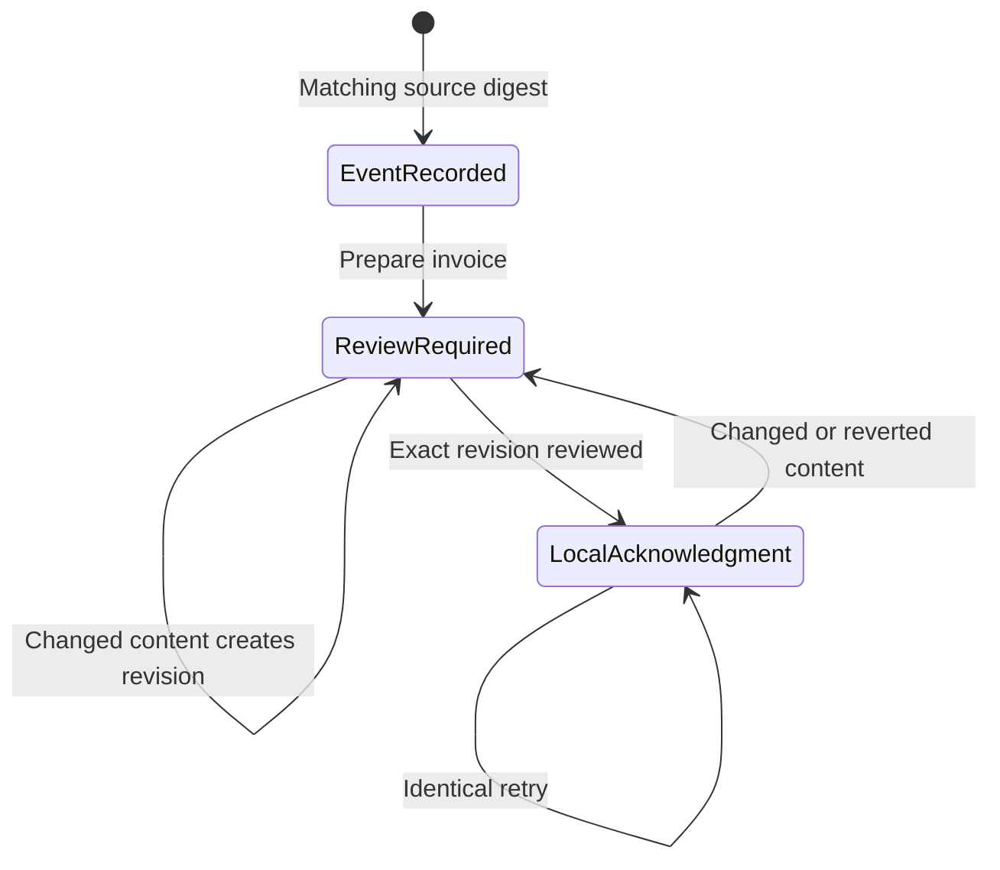

# Local billing event and revision review

This helper preserves the exact invoice a human reviewed and prevents repeated preparation from creating a second reservation for the same event inside one local ledger. It is a preparation tool. It does not authenticate a reviewer, issue invoices, send messages, reconcile payments, encrypt records, or enforce hosted tenant isolation.

## Authority and scope

Source approval stays in the agency's existing human process. `source_review_reference` points to that evidence but does not verify its truth. Names in the engagement's `approvals` object never acknowledge a ledger revision. The separate `review` command records a manual acknowledgment with `authenticated: false` and `external_send_allowed: false`; it cannot authorize a provider action.

Use one protected ledger per agency and preserve it across retries. A new or copied ledger cannot coordinate numbering with another ledger or the finance provider. Anyone with file access can alter the SQLite database; its digests detect mismatched inputs during normal use, not malicious database tampering. Store live material only in an agency-approved private location with appropriate access, backup, retention, and deletion. Never commit ledgers, drafts, or real sources to Git.

Supported scope: one immutable event, one full positive pretax amount, one currency, one reserved draft number, and any number of retained draft revisions. The event amount must exactly match the invoice subtotal. Tax calculation uses the existing bounded draft engine. An event cannot be silently repurposed or its reserved number changed.

Partial billing, cumulative contract budgets, deposits against a larger balance, cancellation/reissue, credits, statutory numbering, authenticated delegations, provider retries, and payment state are outside this helper. Stop and reconcile those cases in the authoritative finance process; do not invent new event IDs to evade a duplicate or amount error. Two IDs for the same real delivery can still duplicate billing; the human must reconcile the commercial source across events.

## Rehearse with the included fictional material

Run from this skill's directory. Use Python 3.12, the version checked in CI. All paths below are local examples. `private/` is ignored by the source repository but that does not itself provide access control.

```bash
mkdir -p private
python scripts/billing_review.py init --ledger private/billing-demo.sqlite3 --agency AGENCY-DEMO
python scripts/billing_review.py record-event --ledger private/billing-demo.sqlite3 --agency AGENCY-DEMO --event assets/billing-event.example.json --source assets/billing-source.example.md
python scripts/billing_review.py prepare --ledger private/billing-demo.sqlite3 --agency AGENCY-DEMO --event-id EVENT-DEMO-001 --record assets/engagement.example.json
```

Read the returned revision and receipt hash. Substitute those exact values for `REVISION` and `RECEIPT` below. The hash is an integrity identifier, not a secret or approval credential.

```bash
python scripts/billing_review.py export --ledger private/billing-demo.sqlite3 --agency AGENCY-DEMO --revision REVISION --receipt RECEIPT --out private/invoice-demo.md
```

The reviewer opens the exported file and checks the source, event basis, billing identity, number, destination, terms, arithmetic, and scope. Only then record their manual acknowledgment:

```bash
python scripts/billing_review.py review --ledger private/billing-demo.sqlite3 --agency AGENCY-DEMO --revision REVISION --receipt RECEIPT --record assets/engagement.example.json --artifact private/invoice-demo.md --reviewer FINANCE-REVIEWER-DEMO --review-reference MANUAL-REVIEW-DEMO-001
python scripts/billing_review.py check --ledger private/billing-demo.sqlite3 --agency AGENCY-DEMO --revision REVISION --receipt RECEIPT --record assets/engagement.example.json --artifact private/invoice-demo.md
python scripts/billing_review.py status --ledger private/billing-demo.sqlite3 --agency AGENCY-DEMO --event-id EVENT-DEMO-001
```

Do not run `review` simply to make a status green. This example records a fictional rehearsal, never Ana's actual approval. No command sends or creates an accounting record. `check` can succeed while returning `HUMAN_REVIEW_REQUIRED`: its exit code verifies matching inputs, not completion of review. Read the returned state.

## What is bound together

The receipt binds an immutable event/source digest, the entire engagement's canonical JSON digest, generated artifact bytes, recipient, finance destination reference, policy version, and a unique revision identity. Whitespace-only JSON formatting and equivalent numeric spellings are normalized; a number and a quoted numeric string remain distinct. A changed semantic value, including an approval declaration, requires re-preparation. Changes are observed only when inputs are supplied to prepare/check/review; the helper does not monitor external files. The actual exported draft must match the stored artifact digest.

The event's supplied SHA-256 must match the source file at registration. The file is not interpreted as a legal agreement, and the helper does not prove the claimed billable amount or source approval. Human reconciliation is necessary even when every digest matches.



No issue/send state exists. The diagram describes local bookkeeping states, not authorization.

## Retry and recovery

| Situation | Behavior and next action |
| --- | --- |
| Exact event repeated | Return the existing immutable event |
| Same event ID with changed fields | Reject; reconcile source in the human process |
| Same preparation repeated | Return the current revision; no second reservation |
| Same invoice number for another event | Reject within this ledger; check provider state as well |
| New content or restored old content | Create a fresh revision; old review does not return |
| Stale receipt, altered record, or edited artifact | Reject review/check; re-prepare and review the current artifact |
| Export failed | Retry export from the persisted revision; do not prepare a replacement event |
| Export path has different content | Refuse overwrite; select a fresh private path |
| Different agency or unsupported database format | Stop; use the correct ledger/version, never bypass the check |

Keep previous revisions for review history. This is a local append-preserving workflow, not an immutable or authenticated audit service. Database corruption or accidental deletion requires recovery from the agency's existing backup process and reconciliation against the finance system.

## Event contract

The strict `billing-event/v1` object requires exactly the fields in `assets/billing-event.example.json`. References and aliases are bounded tokens, not source text or customer identities. Money is a positive exact two-decimal amount in a supported currency. Duplicate JSON keys, unknown event fields, malformed values, and nonfinite numbers fail validation.

Before adding a live adapter, implement authenticated actor/role checks outside model input, source acceptance, cumulative budgets, cross-system idempotency, current-revision authorization, provider readback, and recovery for ambiguous outcomes. The local tests do not satisfy those hosted acceptance gates.
